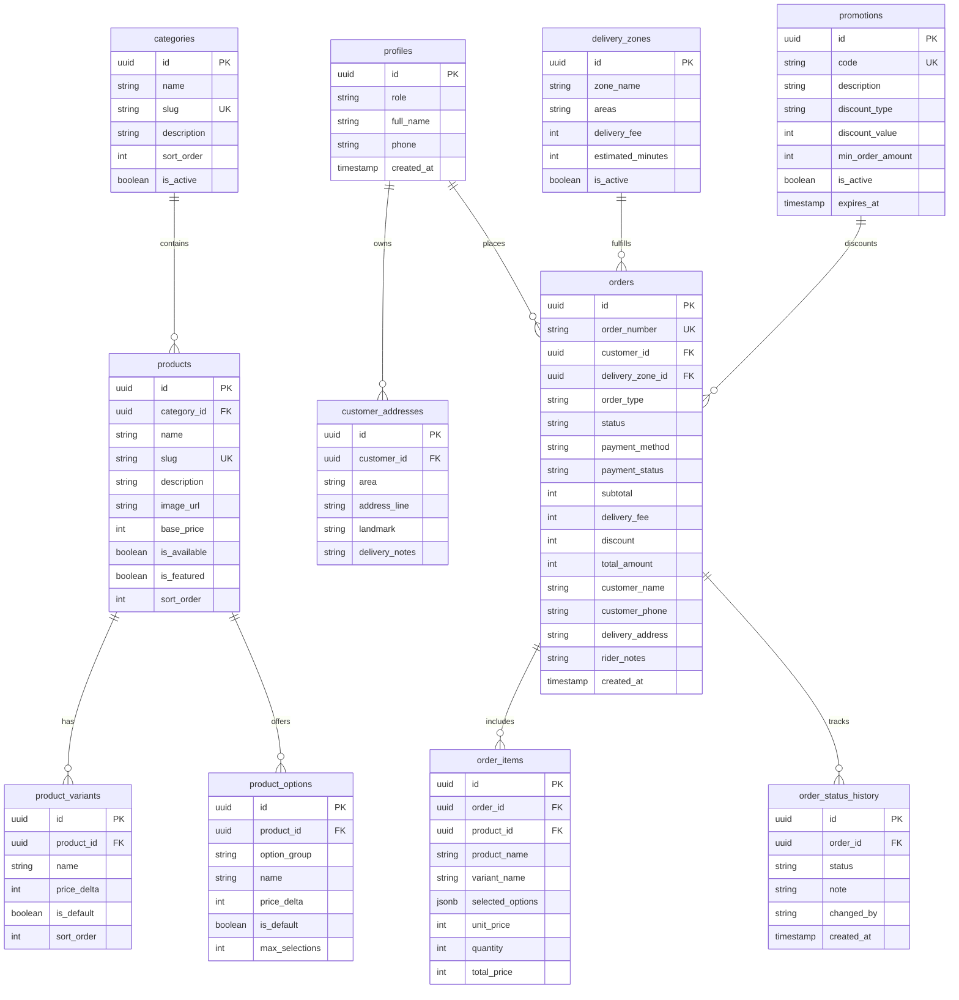

# DE PIZZANO — DATABASE ARCHITECTURE & SCHEMA SPECIFICATION
## Relational Design, Normalization, Security Policies, Immutability & Operational Queries

**Target Engine:** PostgreSQL 15+ (Hosted on Supabase)  
**Lead Architect:** Principal Database Engineer & Backend Architect  
**Date:** November 2026  
**Status:** Approved Canonical Database Architecture  

---

## 1. Schema Overview & Normalization Strategy

The De Pizzano database architecture is modeled to strict Third Normal Form (3NF) standards with foreign key referential integrity, check constraints, domain validation, and immutable snapshots for completed commercial transactions.



---

## 2. Table Specifications & Data Dictionary

### 2.1 Table: `categories`
Defines the 6 official menu categories.
* `id` (`UUID`, PK, default: `gen_random_uuid()`): Unique category identifier.
* `name` (`VARCHAR(100)`, NOT NULL): Category display title (e.g., `Pizza Deals`, `Pizza Flavours`).
* `slug` (`VARCHAR(100)`, NOT NULL, UNIQUE): URL-friendly identifier (e.g., `pizza-deals`).
* `description` (`TEXT`, NULL): Explanatory subtitle displayed in menu and category rail.
* `sort_order` (`INTEGER`, NOT NULL, default: `0`): Ordering sequence in the right-side rail.
* `is_active` (`BOOLEAN`, NOT NULL, default: `true`): Visibility toggle.

### 2.2 Table: `products`
Stores the 50 authentic dishes across all categories.
* `id` (`UUID`, PK, default: `gen_random_uuid()`): Unique product identifier.
* `category_id` (`UUID`, FK -> `categories(id)`, ON DELETE SET NULL): Parent category.
* `name` (`VARCHAR(150)`, NOT NULL): Dish name (e.g., `Tikka Pizza`, `Canzone Sandwich`).
* `slug` (`VARCHAR(150)`, NOT NULL, UNIQUE): URL slug for routing and lookups.
* `description` (`TEXT`, NULL): Detailed culinary description and ingredients.
* `image_url` (`VARCHAR(255)`, NULL): Product food photography path.
* `base_price` (`INTEGER`, NOT NULL, CHECK: `>= 0`): Base price in integer PKR (e.g., Small pizza base = `400`).
* `is_available` (`BOOLEAN`, NOT NULL, default: `true`): Stock availability toggle.
* `is_featured` (`BOOLEAN`, NOT NULL, default: `false`): Highlighted on homepage featured section.
* `sort_order` (`INTEGER`, NOT NULL, default: `0`): Display sort index.
* `created_at` (`TIMESTAMPTZ`, default: `NOW()`): Record creation timestamp.

### 2.3 Table: `product_variants`
Stores size variants (92 verified combinations across pizzas, stuffed crusts, pastas, and sides).
* `id` (`UUID`, PK, default: `gen_random_uuid()`): Unique variant identifier.
* `product_id` (`UUID`, FK -> `products(id)`, ON DELETE CASCADE): Parent dish.
* `name` (`VARCHAR(100)`, NOT NULL): Variant label (e.g., `Small (9")`, `Regular (11")`, `Large (13")`).
* `price_delta` (`INTEGER`, NOT NULL, default: `0`, CHECK: `>= 0`): Additional price added to `base_price` in integer PKR (e.g., Regular: `+350`, Large: `+600`).
* `is_default` (`BOOLEAN`, NOT NULL, default: `false`): Default selected size in customization drawer.
* `sort_order` (`INTEGER`, NOT NULL, default: `0`): Display order.

### 2.4 Table: `product_options`
Stores crust choices, cheese upgrades, and sauce dips.
* `id` (`UUID`, PK, default: `gen_random_uuid()`): Unique option modifier.
* `product_id` (`UUID`, NULL, FK -> `products(id)`): Optional dish-specific link; if NULL, applies globally.
* `option_group` (`VARCHAR(50)`, NOT NULL): Group name (`crust`, `topping`, `dip`, `addon`).
* `name` (`VARCHAR(100)`, NOT NULL): Modifier title (e.g., `Cheese Stuffed Crust`, `Garlic Mayo Dip`).
* `price_delta` (`INTEGER`, NOT NULL, default: `0`, CHECK: `>= 0`): Additional price in integer PKR.
* `is_default` (`BOOLEAN`, NOT NULL, default: `false`): Pre-selected modifier toggle.
* `max_selections` (`INTEGER`, NOT NULL, default: `1`): Maximum permitted selections.

### 2.5 Table: `delivery_zones`
Configures Karachi residential fulfillment territories and delivery tariffs.
* `id` (`UUID`, PK, default: `gen_random_uuid()`): Unique delivery zone identifier.
* `zone_name` (`VARCHAR(100)`, NOT NULL): Zone designation (e.g., `Zone A - Soldier Bazar & Garden`).
* `areas` (`TEXT[]`, NOT NULL): Array of covered localities (`Soldier Bazar`, `Garden East`, `Garden West`, `Patel Para`).
* `delivery_fee` (`INTEGER`, NOT NULL, default: `100`, CHECK: `>= 0`): Standard delivery charge in integer PKR.
* `estimated_minutes` (`INTEGER`, NOT NULL, default: `35`): Estimated dispatch and delivery duration.
* `is_active` (`BOOLEAN`, NOT NULL, default: `true`): Service operational toggle.

### 2.6 Table: `orders`
The central order tracking and financial transaction entity.
* `id` (`UUID`, PK, default: `gen_random_uuid()`): Unique order record identifier.
* `order_number` (`VARCHAR(30)`, NOT NULL, UNIQUE): Human-readable reference (e.g., `DP-20261108-8472`).
* `customer_id` (`UUID`, NULL, FK -> `auth.users(id)`): Linked user account; NULL for guest checkouts.
* `delivery_zone_id` (`UUID`, NULL, FK -> `delivery_zones(id)`): Fulfillment zone.
* `order_type` (`VARCHAR(20)`, NOT NULL, CHECK: `order_type IN ('delivery', 'takeaway')`): Fulfillment method.
* `status` (`VARCHAR(30)`, NOT NULL, CHECK: `status IN ('pending', 'confirmed', 'preparing', 'ready', 'out_for_delivery', 'delivered', 'cancelled')`): 7 kitchen fulfillment milestones.
* `payment_method` (`VARCHAR(50)`, NOT NULL, default: `'Cash on Delivery'`): Method chosen.
* `payment_status` (`VARCHAR(30)`, NOT NULL, default: `'unpaid'`): Commercial payment status (`unpaid`, `paid`, `refunded`).
* `subtotal` (`INTEGER`, NOT NULL, CHECK: `>= 0`): Sum of line-item prices in integer PKR.
* `delivery_fee` (`INTEGER`, NOT NULL, default: `0`, CHECK: `>= 0`): Applicable delivery tariff.
* `discount` (`INTEGER`, NOT NULL, default: `0`, CHECK: `>= 0`): Voucher or deal discount in integer PKR.
* `total_amount` (`INTEGER`, NOT NULL, CHECK: `>= 0`): Calculated grand total: `subtotal + delivery_fee - discount`.
* `customer_name` (`VARCHAR(150)`, NOT NULL): Customer full name.
* `customer_phone` (`VARCHAR(30)`, NOT NULL): Customer telephone contact.
* `customer_email` (`VARCHAR(150)`, NULL): Optional email address.
* `delivery_address` (`TEXT`, NOT NULL): Street, building, apartment, and Karachi neighbourhood.
* `landmark` (`VARCHAR(150)`, NULL): Nearest well-known landmark (e.g., *Near Hamza Uniform*).
* `rider_notes` (`TEXT`, NULL): Special delivery instructions.
* `created_at` (`TIMESTAMPTZ`, NOT NULL, default: `NOW()`): Submission timestamp.
* `updated_at` (`TIMESTAMPTZ`, NOT NULL, default: `NOW()`): Last modification timestamp.

### 2.7 Table: `order_items` (Immutable Transaction Snapshots)
Stores immutable historical line items ensuring historical order records never change if dishes or prices are edited later.
* `id` (`UUID`, PK, default: `gen_random_uuid()`): Unique line item identifier.
* `order_id` (`UUID`, NOT NULL, FK -> `orders(id)`, ON DELETE CASCADE): Parent order ticket.
* `product_id` (`UUID`, NULL, FK -> `products(id)`, ON DELETE SET NULL): Product link.
* `product_name` (`VARCHAR(150)`, NOT NULL): Immutable dish name at time of order.
* `variant_name` (`VARCHAR(100)`, NULL): Chosen size or variant (e.g., `Large (13")`).
* `selected_options` (`JSONB`, NOT NULL, default: `'[]'::jsonb`): Snapshot of chosen crusts, add-ons, dips with individual prices.
* `unit_price` (`INTEGER`, NOT NULL, CHECK: `>= 0`): Unit price including size delta and add-ons in integer PKR.
* `quantity` (`INTEGER`, NOT NULL, CHECK: `> 0`): Quantity ordered.
* `total_price` (`INTEGER`, NOT NULL, CHECK: `>= 0`): `unit_price * quantity`.

### 2.8 Table: `order_status_history`
Maintains a verifiable audit log of every lifecycle transition.
* `id` (`UUID`, PK, default: `gen_random_uuid()`): Unique audit entry.
* `order_id` (`UUID`, NOT NULL, FK -> `orders(id)`, ON DELETE CASCADE): Linked order.
* `status` (`VARCHAR(30)`, NOT NULL): Status state transitioned to.
* `note` (`TEXT`, NULL): Staff notes (e.g., *Order confirmed with customer by telephone*).
* `changed_by` (`VARCHAR(100)`, NOT NULL, default: `'system'`): User ID or `'kitchen_staff'`.
* `created_at` (`TIMESTAMPTZ`, NOT NULL, default: `NOW()`): Transition timestamp.

---

## 3. Row Level Security (RLS) & Access Control Policies

PostgreSQL Row Level Security ensures customer privacy and administrative protection:

```sql
-- 1. Enable RLS on all tables
ALTER TABLE public.categories ENABLE ROW LEVEL SECURITY;
ALTER TABLE public.products ENABLE ROW LEVEL SECURITY;
ALTER TABLE public.product_variants ENABLE ROW LEVEL SECURITY;
ALTER TABLE public.product_options ENABLE ROW LEVEL SECURITY;
ALTER TABLE public.delivery_zones ENABLE ROW LEVEL SECURITY;
ALTER TABLE public.promotions ENABLE ROW LEVEL SECURITY;
ALTER TABLE public.orders ENABLE ROW LEVEL SECURITY;
ALTER TABLE public.order_items ENABLE ROW LEVEL SECURITY;
ALTER TABLE public.order_status_history ENABLE ROW LEVEL SECURITY;

-- 2. Public Read Access for Menu & Catalog
CREATE POLICY "Public can view active categories" ON public.categories FOR SELECT USING (is_active = true);
CREATE POLICY "Public can view available products" ON public.products FOR SELECT USING (is_available = true);
CREATE POLICY "Public can view product variants" ON public.product_variants FOR SELECT USING (true);
CREATE POLICY "Public can view product options" ON public.product_options FOR SELECT USING (true);
CREATE POLICY "Public can view active delivery zones" ON public.delivery_zones FOR SELECT USING (is_active = true);

-- 3. Orders Security Policies
-- Anyone (guests and authenticated customers) can insert new orders via server action
CREATE POLICY "Anyone can create orders" ON public.orders FOR INSERT WITH CHECK (true);

-- Authenticated customers can view only their own orders; guests view via secure orderId token
CREATE POLICY "Customers can view own orders" ON public.orders FOR SELECT
  USING (auth.uid() = customer_id OR auth.role() = 'service_role');

-- Staff / Service Role can update order statuses
CREATE POLICY "Service role can manage all orders" ON public.orders FOR ALL
  USING (auth.role() = 'service_role')
  WITH CHECK (auth.role() = 'service_role');
```

---

## 4. Realtime WebSocket Replication for Order Tracking

To deliver instantaneous status updates without polling:
1. `supabase_realtime` publication includes the `orders` and `order_status_history` tables.
2. The customer tracking client subscribes to:
   `supabase.channel('order-status-' + orderId).on('postgres_changes', { event: 'UPDATE', schema: 'public', table: 'orders', filter: 'id=eq.' + orderId })`.
3. When kitchen staff advances the ticket from `confirmed` to `preparing` or `ready`, PostgreSQL triggers an instant push event to the customer's browser.

