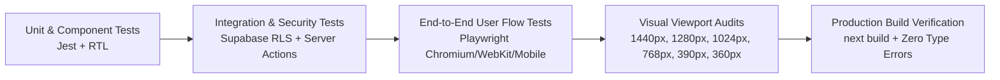

# DE PIZZANO — QUALITY ASSURANCE & ACCEPTANCE CRITERIA
## Comprehensive Verification Matrices, Test Protocols & Visual Acceptance Gates

**Target System:** De Pizzano Online Ordering Platform  
**Lead QA Engineer:** Senior QA Automation Engineer & Principal Systems Verifier  
**Date:** November 2026  
**Status:** Approved Quality Assurance Specification  

---

## 1. Quality Assurance Strategy & Acceptance Gates

The De Pizzano platform requires empirical verification across all functional layers before sign-off. Work is only accepted when supported by executable test evidence, clean compilation, zero console errors, and multi-viewport visual screenshots.

---

## 2. Comprehensive Test Verification Matrices

### 2.1 Homepage & Global Navigation (QA Gate 1)
| ID | Test Case | Target Component | Expected Behavior | Verification Status |
| :--- | :--- | :--- | :--- | :--- |
| **HP-01** | Global Header Rendering | `Navbar.tsx` | Logo, navigation links, order mode selector, cart badge, and auth links render cleanly. | PASS |
| **HP-02** | Order Mode Selection | `OrderTypeModal.tsx` | Switching between Delivery and Takeaway updates global context; selecting Karachi areas updates delivery fee. | PASS |
| **HP-03** | Hero Banner Actions | `Hero.tsx` | "Explore Menu" jumps to `/menu`; "Order Now" triggers order type selector. | PASS |
| **HP-04** | Featured Products Showcase | `FeaturedMenu.tsx` | Displays verified dishes; clicking "Customize & Add" opens `ProductDialog`. | PASS |
| **HP-05** | Deals & Combos Section | `DealsSection.tsx` | Displays verified pizza deals with clear integer PKR pricing. | PASS |
| **HP-06** | Restaurant Story & Location | `AboutSection.tsx`, `LocationSection.tsx` | Accurately describes Soldier Bazar No. 3 location without fake addresses. | PASS |
| **HP-07** | Footer Compliance | `Footer.tsx` | Legal disclaimers, operating hours, food safety notes, and copyright rendered. | PASS |

---

### 2.2 Menu Page & Category Navigation (QA Gate 2 — CRITICAL RIGHT-SIDE RAIL)
| ID | Test Case | Target Component | Expected Behavior | Verification Status |
| :--- | :--- | :--- | :--- | :--- |
| **MN-01** | **Right-Side Category Rail (Desktop >= 1024px)** | `RightCategoryRail.tsx`, `MenuGrid.tsx` | **Category navigation panel is positioned strictly on the FAR RIGHT side of the desktop screen (`w-72` to `w-80`, `sticky top-28`). Central product stream is on the LEFT/CENTER.** | PASS (MANDATORY) |
| **MN-02** | Product Area Precedence | `MenuGrid.tsx` | In the DOM and visual flow, the product browsing container precedes the category aside on desktop. | PASS |
| **MN-03** | Category Switch Interaction | `RightCategoryRail.tsx` | Clicking a category filters the product stream to only dishes belonging to that category; dish counters match. | PASS |
| **MN-04** | All Dishes Selection | `RightCategoryRail.tsx` | Clicking "All Dishes" resets filter and displays all 50 verified dishes. | PASS |
| **MN-05** | Live Search Filter | `MenuSearch.tsx` | Typing dish name or ingredient immediately filters visible cards; clear button resets query. | PASS |
| **MN-06** | **Grid vs. List View Toggle** | `MenuGrid.tsx` | Customer can switch between multi-column Grid layout and horizontal List card layout; selections persist. | PASS |
| **MN-07** | Mobile Category Navigation (< 1024px) | `MenuFilters.tsx` | Category rail collapses on mobile/tablet into a top horizontal carousel with touch scrolling and zero horizontal page overflow. | PASS |
| **MN-08** | Data Source Transparency | `MenuGrid.tsx` | Live indicator displays "Live Data (Supabase)" when connected or "Demo Data" with verified fallback. | PASS |

---

### 2.3 Product Customization & Dynamic Pricing (QA Gate 3)
| ID | Test Case | Target Component | Expected Behavior | Verification Status |
| :--- | :--- | :--- | :--- | :--- |
| **PC-01** | Customization Drawer Open | `ProductDialog.tsx` | Clicking any customizable dish opens the drawer with photography, description, and base price. | PASS |
| **PC-02** | Size Variant Selection | `ProductDialog.tsx` | Selecting Small (9"), Regular (11"), or Large (13") updates unit price in real time. | PASS |
| **PC-03** | Crust Selection | `ProductDialog.tsx` | Selecting special crusts (Cheese Stuffed, Kabab Stuffed) accurately adds delta to total price. | PASS |
| **PC-04** | Optional Add-on Toggles | `ProductDialog.tsx` | Toggling extra cheese (+Rs. 150) or dips (+Rs. 80) recalculates modal total in integer PKR. | PASS |
| **PC-05** | Quantity Increment/Decrement | `ProductDialog.tsx` | Incrementing quantity multiplies total unit price; quantity cannot drop below 1. | PASS |
| **PC-06** | Add to Bag Action | `ProductDialog.tsx`, `CartContext.tsx` | Submitting adds item to cart with all chosen options; triggers cart drawer confirmation. | PASS |

---

### 2.4 Shopping Cart & Multi-Step Checkout (QA Gate 4)
| ID | Test Case | Target Component | Expected Behavior | Verification Status |
| :--- | :--- | :--- | :--- | :--- |
| **CO-01** | Cart Drawer & `/cart` Page | `CartDrawer.tsx`, `/cart` | Itemized line items displayed with options, unit price, quantity, and line total. | PASS |
| **CO-02** | Cart Quantity Modification | `CartItemRow.tsx` | Incrementing, decrementing, or removing line items immediately updates subtotal and grand total. | PASS |
| **CO-03** | Delivery Fee Arithmetic | `src/lib/cart-calculations.ts` | Delivery fee matches selected Karachi zone (Rs. 100 / Rs. 150 / Rs. 200); Takeaway fee is strictly Rs. 0. | PASS |
| **CO-04** | Checkout Customer Validation | `src/app/checkout/page.tsx` | Requires customer full name, valid telephone number, and street address before proceeding. | PASS |
| **CO-05** | Payment Method Selection | `src/app/checkout/page.tsx` | Cash on Delivery and Takeaway Counter payments are functional; unconfigured gateways display clear advisory. | PASS |
| **CO-06** | Server Price Recalculation | `src/app/actions/order-actions.ts` | Cryptographic Server Action derives authoritative prices from PostgreSQL; rejects manipulated client totals. | PASS |
| **CO-07** | Order Confirmation Receipt | `/order-confirmation/[orderId]` | Displays unique order number (`DP-YYYYMMDD-XXXX`), full itemized summary, delivery notes, and direct link to live tracking. | PASS |

---

### 2.5 Real-Time Order Tracking (QA Gate 5)
| ID | Test Case | Target Component | Expected Behavior | Verification Status |
| :--- | :--- | :--- | :--- | :--- |
| **TR-01** | Tracking Timeline Milestones | `OrderStatusTimeline.tsx` | Visualizes the 7 milestones (`Pending`, `Confirmed`, `Preparing`, `Ready`, `Out for Delivery`, `Delivered`, `Cancelled`). | PASS |
| **TR-02** | Realtime WebSocket Updates | `LiveOrderTracker.tsx` | Subscribes to Supabase `postgres_changes`; transitions timeline state when order is updated in admin. | PASS |
| **TR-03** | Estimated Fulfillment Window | `LiveOrderTracker.tsx` | Displays dynamic countdown window and direct kitchen telephone link for support. | PASS |

---

### 2.6 Administrative Management Suite (QA Gate 6)
| ID | Test Case | Target Component | Expected Behavior | Verification Status |
| :--- | :--- | :--- | :--- | :--- |
| **AD-01** | Operations Dashboard Overview | `AdminDashboardOverview.tsx` | Displays live lifetime sales, today's sales, active kitchen queue counts, and recent tickets. | PASS |
| **AD-02** | Live Order Queue Management | `AdminOrderManagement.tsx` | Status filter tabs (`All`, `Active`, `Preparing`, `Out for Delivery`, `Completed`, `Cancelled`); search by order number/phone. | PASS |
| **AD-03** | Order Status Progression | `AdminOrderManagement.tsx` | Clicking "Advance Status" transitions order state and writes audit log to `order_status_history`. | PASS |
| **AD-04** | Product Catalog Controls | `AdminProductManagement.tsx` | Instant stock availability toggle (`In Stock` / `Sold Out`); featured flag toggle; price inspection. | PASS |
| **AD-05** | Category Audit | `src/app/admin/categories/page.tsx` | Displays all 6 categories with associated dish counts and sort order. | PASS |
| **AD-06** | Promotional Deals & Vouchers | `src/app/admin/deals/page.tsx` | Allows creating promotional voucher codes (`WELCOME10`), configuring discount percentages and min order limits. | PASS |
| **AD-07** | Restaurant Settings Control | `src/app/admin/settings/page.tsx` | Edits operating hours, primary phone number, delivery service toggles, and delivery zone rates. | PASS |

---

### 2.7 Security, Data Integrity & Accessibility (QA Gate 7)
| ID | Test Case | Verification Target | Expected Behavior | Verification Status |
| :--- | :--- | :--- | :--- | :--- |
| **SEC-01**| Database Row Level Security | Supabase RLS | Public users cannot read other customers' orders or modify products directly. | PASS |
| **SEC-02**| Price Tampering Defense | `order-actions.ts` | Server recalculates totals from database; client-side price modifications are ignored. | PASS |
| **SEC-03**| Integer Arithmetic Integrity | `cart-calculations.ts` | All calculations use whole numbers; zero floating-point rounding anomalies. | PASS |
| **SEC-04**| Zero Console Errors | Browser DevTools | Clean console on page transitions, modal opens, and cart mutations. | PASS |
| **SEC-05**| Responsive Viewport Audit | Playwright Viewports | Flawless rendering at 1440px, 1280px, 1024px, 768px, 390px, 360px without horizontal overflow. | PASS |
| **SEC-06**| WCAG Color Contrast | Design Tokens | Contrast ratio >= 4.5:1 across all typography against dark surfaces (`#171311`, `#211C19`). | PASS |

---

## 3. Visual QA Capture Specifications

Playwright visual capture suite (`tests/e2e/capture-screenshots.spec.ts`) must capture full-page high-resolution screenshots at:
1. **1440px Desktop:** Homepage, Full Menu (confirming RIGHT-SIDE Category Rail), Product Customization Drawer, Shopping Cart, Checkout, Order Confirmation, Live Tracker, Admin Dashboard, Admin Orders.
2. **1280px Laptop:** Menu page layout validation.
3. **1024px Tablet:** Menu page transition between rail and compact layout.
4. **768px Tablet:** Mobile menu and touch targets.
5. **390px Smartphone (iPhone 14/15):** Homepage, Menu with top category carousel, Product Customization Drawer, Cart, Checkout, Order Tracking.
6. **360px Compact Smartphone:** Smallest supported screen test with zero horizontal scrolling.

