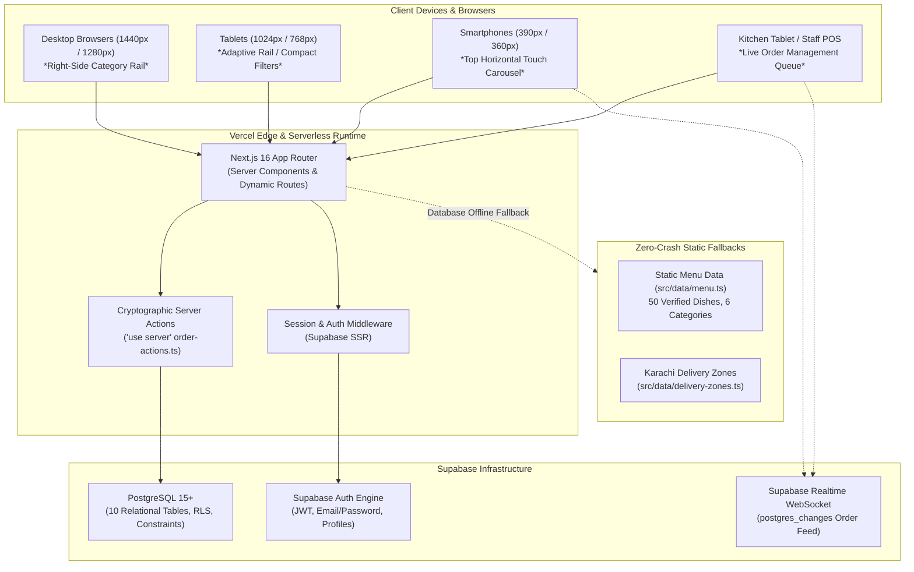

# DE PIZZANO — SYSTEM ARCHITECTURE & MODULE BLUEPRINT
## Complete System Design, Application Topology, Data Flows & Component Structure

**System:** De Pizzano Online Ordering & Restaurant Operations Platform  
**Target Domain:** https://de-pizzano-website.vercel.app/  
**Location:** Soldier Bazar No. 3, Karachi, Pakistan  
**Architect:** Principal Full-Stack Solutions Architect & E-Commerce Lead  
**Date:** November 2026  
**Status:** Approved System Architecture Specification  

---

## 1. System Topology & Architecture Overview

The De Pizzano platform is designed as an end-to-end, full-stack restaurant e-commerce system built on Next.js 16 (App Router), React 19, TypeScript, Tailwind CSS, and Supabase PostgreSQL.

---

## 2. Customer-Facing Module Specifications

### 2.1 Global Header & Order Mode Selector
* **Route:** Mounted globally in `src/app/layout.tsx` via `Navbar.tsx` and `OrderTypeModal.tsx`.
* **State Management:** `CartContext` maintains `orderType: 'delivery' | 'takeaway'` and `deliveryZone`.
* **Capabilities:**
  - One-click order type toggle (`🛵 Delivery` vs `🏪 Takeaway Pickup`).
  - Interactive Karachi neighbourhood selector (Soldier Bazar, Garden, Saddar, PECHS, etc.).
  - Real-time cart item count badge with drawer trigger.
  - Customer account entry point (Sign In / Register / My Orders).

### 2.2 Hero & Homepage Showcase
* **Route:** `/` (`src/app/page.tsx`).
* **Components:** `Hero.tsx`, `FeaturedMenu.tsx`, `DealsSection.tsx`, `AboutSection.tsx`, `Gallery.tsx`, `LocationSection.tsx`, `Footer.tsx`.
* **Capabilities:**
  - Artisanal storytelling emphasizing daily fresh fermented dough, stone baking, and Karachi palate infusions.
  - Prominent "Order Now" and "Explore Menu" CTAs.
  - Dedicated Featured Dishes showcase with direct customization triggers.
  - Value Deals showcase section with clear combo pricing.

### 2.3 Interactive Full Menu Page (Non-Negotiable Right-Side Navigation)
* **Route:** `/menu` (`src/app/menu/page.tsx`).
* **Components:** `MenuGrid.tsx`, `RightCategoryRail.tsx`, `MenuCard.tsx`, `MenuFilters.tsx`, `MenuSearch.tsx`, `ProductDialog.tsx`.
* **Desktop Structural Layout:**
  - Main header spanning the top.
  - Central product stream on the **LEFT/CENTER** occupying ~75–80% width.
  - Dedicated category rail on the **FAR RIGHT** occupying 280px (`sticky top-28`).
* **Capabilities:**
  - Dynamic category switching (All Dishes, Pizza Deals, Pizza Flavours, Special Flavours, Sandwiches, Pasta & Fries, Sides).
  - Instant text search matching title, category, and ingredients.
  - View switcher: **Grid View** (responsive multi-column) vs **List View** (horizontal row cards).
  - Live dish counters per category.
  - Real-time data source indicator (Live Supabase vs. Fallback data).

### 2.4 Product Customization Drawer / Modal
* **Component:** `ProductDialog.tsx`.
* **Capabilities:**
  - Tactile size selection: Small (9"), Regular (11"), Large (13") with automatic price recalculation.
  - Crust selection: Pan Crust, Thin Crust, Cheese Stuffed (+Rs. 200), Kabab Stuffed (+Rs. 250).
  - Optional add-ons: Extra Cheese (+Rs. 150), Dipping Sauces (+Rs. 80), Meat toppings (+Rs. 150).
  - Kitchen special instructions field.
  - Quantity counter with minimum 1 validation.
  - Seamless add-to-bag with sliding drawer notification.

### 2.5 Shopping Cart Review & Drawer
* **Routes / Components:** `CartDrawer.tsx` (slide-over) and `/cart` (`src/app/cart/page.tsx`).
* **Capabilities:**
  - Real-time itemized line items showing product, chosen size, modifiers, and quantity.
  - Quantity increment, decrement, and line removal.
  - Delivery fee estimation based on selected Karachi delivery zone.
  - Pure integer PKR arithmetic: `Subtotal + Delivery Fee - Discount = Total`.
  - Direct navigation to Checkout.

### 2.6 Multi-Step Checkout Journey
* **Route:** `/checkout` (`src/app/checkout/page.tsx`).
* **Capabilities:**
  - Step 1: Order Method confirmation (Delivery vs. Takeaway).
  - Step 2: Customer Contact (Full Name, Phone Number).
  - Step 3: Delivery Address (Karachi Area, Complete Street Address, Landmark, Rider Notes).
  - Step 4: Payment Method (Cash on Delivery / Takeaway Counter / Online Payment).
  - Step 5: Server-side submission via `placeOrderAction`.
  - Anti-tampering recalculation: Frontend submits only product IDs, variant IDs, option IDs, and quantities; server queries PostgreSQL to derive the authoritative price.

### 2.7 Live Real-Time Order Tracker
* **Route:** `/track/[orderId]` (`src/app/track/[orderId]/page.tsx`).
* **Components:** `LiveOrderTracker.tsx`, `OrderStatusTimeline.tsx`, `OrderStatusBadge.tsx`.
* **Capabilities:**
  - 7 sequential milestones:
    1. `Pending / Order Received`
    2. `Order Confirmed`
    3. `Preparing in Kitchen`
    4. `Ready for Pickup / Dispatch`
    5. `Out for Delivery`
    6. `Delivered`
    7. `Cancelled`
  - Live Supabase Realtime WebSocket subscription (`postgres_changes` event on `orders` table).
  - Dynamic estimated delivery countdown and kitchen telephone link.

### 2.8 Customer Authentication & Account Suite
* **Routes:** `/login`, `/register`, `/orders`.
* **State Management:** `AuthContext.tsx`.
* **Capabilities:**
  - Customer email/password registration and sign-in.
  - Password recovery workflow.
  - Customer profile and past order history review with one-click reordering.
  - Seamless guest checkout without forced registration.

---

## 3. Administrative Management Suite Specifications

The administrative suite is housed under the `/admin` path and protected by role authorization.

### 3.1 Operations Dashboard Overview
* **Route:** `/admin` (`src/app/admin/page.tsx`).
* **Component:** `AdminDashboardOverview.tsx`.
* **Metrics:**
  - Total Lifetime Orders & Revenue in integer PKR.
  - Today's Orders and Today's Revenue.
  - Active Orders Queue (Pending, Confirmed, Preparing, Ready, Out for Delivery).
  - Real-time order cards with immediate status progression triggers.

### 3.2 Live Order Management
* **Route:** `/admin/orders` (`src/app/admin/orders/page.tsx`).
* **Component:** `AdminOrderManagement.tsx`.
* **Capabilities:**
  - Filter orders by status tabs (`All`, `Active`, `Preparing`, `Out for Delivery`, `Completed`, `Cancelled`).
  - Search by order number, customer name, phone number, or address.
  - Order detail inspection (line items, crusts, add-ons, rider notes, payment status).
  - Status progression buttons: Advance status with automatic audit logging to `order_status_history`.

### 3.3 Menu Product Catalog Management
* **Route:** `/admin/products` (`src/app/admin/products/page.tsx`).
* **Component:** `AdminProductManagement.tsx`.
* **Capabilities:**
  - Filter dishes by category and availability.
  - Instant toggle for stock availability (`In Stock` vs `Sold Out`).
  - Featured product toggle (`Featured on Homepage`).
  - Product price and description auditing.

### 3.4 Menu Categories Management
* **Route:** `/admin/categories` (`src/app/admin/categories/page.tsx`).
* **Capabilities:**
  - View all 6 official categories.
  - Inspect product counts assigned to each category.
  - Audit sort order and active status.

### 3.5 Deals & Promotions Management
* **Route:** `/admin/deals` (`src/app/admin/deals/page.tsx`).
* **Capabilities:**
  - Review the 10 official Pizza Deals and bundle contents.
  - Create and toggle promotional voucher codes (e.g., `WELCOME10`, `SOLDIERBAZAR`).
  - Configure discount types (percentage vs. fixed PKR amount), minimum order limits, and expiration dates.

### 3.6 Restaurant Operating Settings
* **Route:** `/admin/settings` (`src/app/admin/settings/page.tsx`).
* **Capabilities:**
  - Update public kitchen operating hours.
  - Update primary contact and delivery dispatch phone numbers.
  - Toggle home delivery service availability and takeaway counter availability.
  - Audit Karachi delivery zone tariffs and estimated delivery windows.
  - Payment gateway configuration status inspector.

---

## 4. Payment Architecture & Integration Strategy

1. **Cash on Delivery (COD):** Fully functional and active across all Karachi delivery zones.
2. **Takeaway Counter Payment:** Fully functional for pickups at Soldier Bazar No. 3.
3. **Online Digital Payments (Credit/Debit / JazzCash / EasyPaisa):**
   - Architected via pluggable server-side payment adapter pattern.
   - When merchant credentials are not yet configured in environment variables, the system clearly displays **"Online Payment Unconfigured - Cash on Delivery Available"** rather than generating fake or mocked payment success screens.
   - Prevents unauthorized simulated transactions while providing production-ready integration points.

---

## 5. Zero-Crash Reliability & Resilience Architecture

The platform implements a multi-tier fallback architecture:
1. **Primary Tier (Supabase Database):** Real-time PostgreSQL queries via `src/lib/supabase/services/menu-service.ts`.
2. **Secondary Tier (Static Fallback Dataset):** If Supabase is unreachable, disconnected, or unconfigured, the application automatically falls back to `src/data/menu.ts`, containing all 50 verified dishes across all 6 categories.
3. **Integer Arithmetic:** All currency operations strictly enforce integer math, eliminating JavaScript floating-point rounding bugs (e.g., `Rs. 400.0000000001`).

